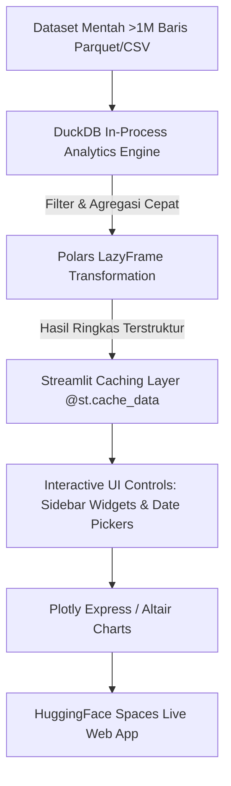

# Dokumen Arsitektur & Pitch Proposal Produk Data (Phase 1)

**Mata Kuliah:** Analisis Big Data  
**Target Check-in:** Pertemuan 10 (Diumumkan Pertemuan 8, repositori dibagikan Pertemuan 9)  
**Nama Tim:** [Tuliskan Nama Tim]  
**Topik / Judul Produk Data:** [Contoh: Dashboard Pemantauan Cuaca Ekstrem dan Kualitas Udara Indonesia]  

---

## 1. Problem Statement & Sasaran Pengguna (The Pitch)

### 1.1 Latar Belakang Masalah
*Jelaskan permasalahan nyata atau kebutuhan analisis yang ingin diselesaikan melalui dashboard analitik ini. Mengapa data besar ini perlu disajikan secara interaktif?*

### 1.2 Target Pengguna (Target Audience)
*Siapa pengguna utama produk data ini? (Misal: analis meteorologi BMKG, pemangku kebijakan bencana daerah, pelaku logistik maritim, atau masyarakat umum).*

### 1.3 Nilai Tambah & Wawasan Utama
*Wawasan atau keputusan apa yang bisa diambil oleh pengguna setelah berinteraksi dengan dashboard ini?*

---

## 2. Sumber Dataset & Skala Data

| Parameter | Keterangan |
|-----------|------------|
| **Nama Dataset** | [Nama Dataset, misal: BMKG Open Data / Satu Data Indonesia / E-Commerce] |
| **Sumber Resmi** | [Tautan URL portal data] |
| **Format Awal** | [CSV / Parquet / JSON API] |
| **Ukuran Data** | [Minimal >500 MB atau >1 Juta Baris] |
| **Dimensi Waktu / Temporal** | [Rentang tanggal data, misal: 2024–2026, frekuensi per menit/jam] |
| **Fitur / Kolom Kunci** | [Sebutkan kolom-kolom analitik penting] |

---

## 3. Diagram Arsitektur Data & Aliran Informasi

Gambarkan alur bagaimana data mengalir dari disk mentah hingga ke antarmuka pengguna:

---

## 4. Rencana Pemrosesan Data & Strategi Caching

### 4.1 Peran DuckDB (SQL Engine)
- Bagaimana data dibaca? (Contoh: pembacaan langsung direktori file Parquet berpartisi temporal).
- Operasi analitik berat apa yang didelegasikan ke DuckDB? (Contoh: `SUMMARIZE`, window function running total, agregasi bulanan/wilayah).

### 4.2 Peran Polars (Transformasi Data)
- Operasi apa yang dilakukan di Polars? (Contoh: pembuatan fitur lag, moving average, dekomposisi temporal, atau pivoting).

### 4.3 Strategi Optimasi Memori & Caching Streamlit
- Bagaimana mencegah aplikasi reload lambat saat pengguna mengubah filter? (Gunakan `@st.cache_data` pada fungsi kueri berat).
- Batas memori cloud HuggingFace Spaces gratis adalah 16GB RAM; pastikan tidak menyimpan dataset mentah 1 juta baris langsung di memori Streamlit session state!

---

## 5. Rencana Tampilan Dashboard (Wireframe & Fitur UI)

1. **Header & Key Metrics KPI:**
   - 4 Kartu metrik ringkasan (Total data, rata-rata, rekor ekstrem, tren persentase).
2. **Filter Interaktif (Sidebar):**
   - Pemilihan stasiun/wilayah, slider rentang tanggal, filter kategori.
3. **Panel Visualisasi Utama:**
   - **Tab 1 — Tren Temporal:** Line chart interaktif dengan range slider dan moving average.
   - **Tab 2 — Analisis Distribusi & Anomali:** Box plot dan deteksi pencilan.
   - **Tab 3 — Peta Wilayah / Spasial:** Choropleth map sebaran provinsi atau scatter map koordinat stasiun.
   - **Tab 4 — Tabel Data Detail:** Tampilan cuplikan data terfilter dengan opsi download ringkasan CSV.

---

## 6. Pembagian Tugas & Tanggung Jawab Anggota Tim

| Anggota Tim | Tanggung Jawab Utama di Phase 1 - 4 |
|-------------|-------------------------------------|
| Mahasiswa 1 | Desain arsitektur, data pipeline, dan integrasi Dockerfile |
| Mahasiswa 2 | Penyusunan kueri analitik DuckDB dan optimasi partisi Parquet |
| Mahasiswa 3 | Desain antarmuka Streamlit, visualisasi Plotly, dan deployment ke HF Spaces |
